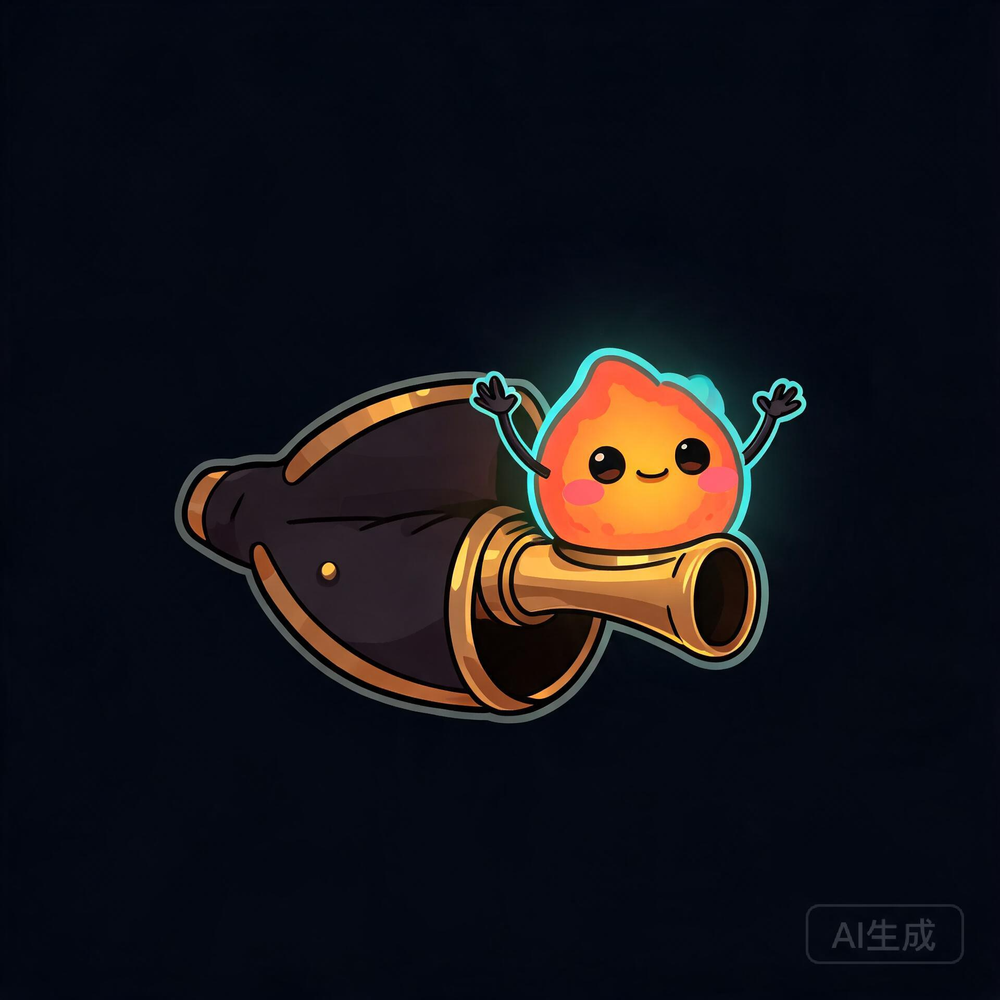
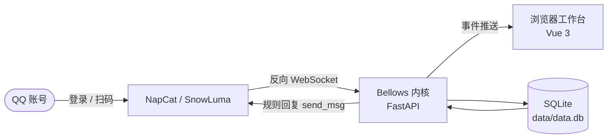

# Bellows · 风箱



[](CHANGELOG.md)
[](LICENSE)
[](https://www.python.org/)
[](https://vuejs.org/)
[](https://github.com/Kei7295/Bellows/actions/workflows/ci.yml)
[](https://github.com/Kei7295/Bellows/actions/workflows/windows-desktop.yml)

> **协议进风，人格出火。**
>
> 一台跑在你本机的 QQ 聊天 BOT 工作台。把协议端的风送进来，让人格的火烧起来。


*概念图，AI 生成——真实界面长什么样，`bash scripts/run.sh` 之后自己看。*

## 为什么叫「风箱」？

因为真正的风箱从不假装自己是炉子。

它不负责点火（QQ 登录交给 NapCat / SnowLuma），不负责炼钢（消息协议由 OneBot v11 负责），它只做一件事：**把风稳定地送进炉膛**。火旺不旺，取决于你往里面塞了什么——人格、规则、记忆，或者未来某天真正的大模型。

所以 Bellows 的定位是**工作台**，不是又一个全能 BOT。它把实例、消息、人格、日志摊开在桌面上，让你看得见风从哪来、火往哪去。

## 三分钟点火

```bash
bash scripts/run.sh
```

打开 <http://127.0.0.1:7801>。首次运行脚本会自动：

1. 在 `apps/web` 下 `npm install` + `npm run build`（只在 `dist/index.html` 缺失时）；
2. 安装 Python 依赖 `fastapi` / `uvicorn`（只在缺失时）；
3. 启动内核，数据写入 `data/`（SQLite WAL）。

**没有 QQ 账号也能点火**：内置演示管线每 11–18 秒往炉子里丢一条消息，附赠一条规则回复，界面不会对着空聊天框发呆。

点火条件：

| 条件 | 说明 |
| --- | --- |
| Python ≥ 3.12 | 内核 |
| Node.js ≥ 22.18 或 ≥ 24.12 | 仅首次构建前端需要 |
| 端口 `7801` | 可用 `BELLOWS_PORT` 覆盖 |
| 数据目录 `data/` | 可用 `BELLOWS_DATA_DIR` 覆盖 |

想换个灶台：

```bash
BELLOWS_PORT=7801 bash scripts/run.sh
```

想用 Docker 把整台风箱装箱：

```bash
cp .env.example .env        # 至少改掉 BELLOWS_TOKEN
docker compose up -d --build
```

### Windows 桌面版

不想装 Python/Node？直接下安装包：

1. 打开 [Releases](https://github.com/Kei7295/Bellows/releases/latest)，下载 `Bellows_0.0.1-beta_x64-setup.exe`（或从 Actions 的 `bellows-windows-nsis` 产物获取）。
2. 双击安装。安装包未签名，SmartScreen 可能提示「未知发布者」，选择「更多信息 → 仍要运行」。
3. 启动后桌面壳会自己拉起内置内核，数据写到 `%APPDATA%\dev.bellows.desktop`，端口自动选择空闲值。

内核与前端都打在同一个安装包里，不需要本机 Python、Node 或 NapCat；接真实 QQ 仍需在 NapCat / SnowLuma 配置反向 WS。

## 现在能烧什么（v0.0.1 BETA）

| 能力 | 状态 |
| --- | --- |
| 桌面式 App Shell（自定义标题栏、可折叠侧栏、亮/暗/跟随系统） | 可用 |
| Windows 桌面版（Tauri 2 + NSIS，内置 Python 内核） | 可用（CI 构建） |
| 总览：在线实例、今日消息/回复/Token、14 天趋势、事件流、告警 | 可用 |
| 实例 CRUD、连接/断开、能力探测、原始配置查看 | 可用 |
| OneBot v11 反向 WS：`ws://127.0.0.1:7801/onebot/v11/ws/<实例ID>`，Bearer Token 校验 | 可用 |
| 消息归一化、落库、`/api/events` 实时推送、控制台人工发送 | 可用 |
| 演示管线：每 11–18 秒生成入站消息与规则回复 | 可用 |
| 会话列表、消息检索、人格 CRUD、Provider CRUD、记忆浏览/删除 | 可用 |
| 插件列表与开关、只读市场预览 | 状态可落库；运行时不加载 |
| 日志 / 审计检索、设置持久化 | 可用 |
| SQLite 持久化与首次种子数据（3 实例、6 会话、30 消息、14 天统计） | 可用 |

## 现在还烧不起来什么（诚实边界）

BETA 的意思是：**能用，但别把炉子当成钢厂**。

| 项 | 说明 |
| --- | --- |
| 桌面版覆盖范围 | 只发布 Windows（NSIS）；macOS / Linux 桌面包未验证，仍用脚本或 Docker。 |
| 代码签名 / 自动更新 | 安装包未签名，SmartScreen 会提示；升级需手动下载新版本。 |
| 真实 LLM 推理 | **未接入**。Provider 的「测试」返回 `mode: "simulated"`；回复由规则引擎生成。 |
| 插件运行时 | **未实现**。开关只写数据库与审计日志，`reload` 返回未实现；市场只读。 |
| 正向 WS / HTTP 接入 | 仅 scaffold；BETA 只有反向 WS。 |
| 钥匙串 / 密钥存储 | 只存 `secret_ref` 标识，没有真实密钥读写。 |
| 自动记忆抽取 / 向量检索 / MCP / 调度器 | 未实现。 |
| 登录 / 扫码 | 永远由 NapCat / SnowLuma 完成，Bellows 不碰 QQ 登录协议。 |

## 一张图看懂风向



内核是单进程：REST API、`/api/events` 事件流、OneBot 反向 WS、SPA 静态资源，全在同一扇门后。更细的模块拆解见 [docs/ARCHITECTURE.md](docs/ARCHITECTURE.md)。

## 接入真实协议端（反向 WS）

1. 在 NapCat 或 SnowLuma 中开启「反向 WebSocket」。
2. 地址填：

   ```text
   ws://127.0.0.1:7801/onebot/v11/ws/<实例ID>
   ```

   种子实例 `ins_second` 的 Access Token 是 `beta-token`；新建实例时填的 Token 必须与协议端一致，留空则不校验。
3. 协议端连上后实例变成「在线」，日志里出现「协议端已连接实例 …」。
4. 群聊 @ 机器人、消息含「风箱」、或私聊消息会触发 BETA 规则回复，回复沿同一 WS 以 `send_msg` 动作回去。

没有协议端时，可以直接往炉膛里塞一条测试消息：

```bash
curl -s -X POST http://127.0.0.1:7801/api/debug/inbound \
  -H 'Content-Type: application/json' \
  -d '{"instance_id":"ins_main","text":"风箱，测试一条消息。","sender_name":"探针"}'
```

更多排查见 [docs/ONEBOT.md](docs/ONEBOT.md)。

## 开发 = 自己拉风箱

```bash
# 终端 1：内核
cd apps/core && python3 -m bellows_core --data-dir ../../data --port 7801

# 终端 2：前端（Vite 把 /api 与 /onebot 代理到 7801）
cd apps/web && npm run dev
```

提交前拉一下总闸：

```bash
bash scripts/check.sh
# 等价于：ruff check / ruff format --check / pytest / vue-tsc / vite build
```

13 个 pytest 用例全部使用临时数据目录，不会弄脏你的 `data/`。

## API 速查

| 方法 | 路径 | 说明 |
| --- | --- | --- |
| GET | `/api/health` | 健康检查（唯一免鉴权） |
| GET | `/api/overview` | 总览聚合 |
| GET/POST | `/api/instances` | 实例列表 / 创建 |
| PATCH/DELETE | `/api/instances/{id}` | 更新 / 删除 |
| POST | `/api/instances/{id}/connect`、`/disconnect` | 连接 / 断开 |
| GET | `/api/instances/{id}/capabilities` | 能力探测 |
| GET | `/api/streams`、`/api/streams/{id}/messages` | 会话与消息 |
| POST | `/api/streams/{id}/send` | 人工发送（可带演示回复） |
| WS | `/api/events` | 实时事件流 |
| WS | `/onebot/v11/ws/{instance_id}` | OneBot v11 反向 WS |
| CRUD | `/api/personas`、`/api/providers` | 人格 / Provider |
| GET/DELETE | `/api/memories` | 记忆 |
| GET | `/api/plugins`、`/api/plugins/market` | 插件 / 市场预览 |
| GET | `/api/logs`、`/api/audit` | 日志 / 审计 |
| GET/PUT | `/api/settings` | 设置 |

启动时传 `--token` 后，除 `/api/health` 外的 `/api` 都要带 `Authorization: Bearer <token>`。完整请求体与状态码见 [docs/API.md](docs/API.md)。

## 文档地图

| 文档 | 什么时候点开它 |
| --- | --- |
| [docs/ARCHITECTURE.md](docs/ARCHITECTURE.md) | 想知道风到底怎么走的 |
| [docs/API.md](docs/API.md) | 想绕过界面直接调接口 |
| [docs/DEVELOPMENT.md](docs/DEVELOPMENT.md) | 想改代码、跑测试、修环境 |
| [docs/DEPLOYMENT.md](docs/DEPLOYMENT.md) | 源码 / Docker / systemd 部署与备份 |
| [docs/ONEBOT.md](docs/ONEBOT.md) | NapCat / SnowLuma 连不上 |
| [docs/FAQ.md](docs/FAQ.md) | 「为什么回复像复读机？」 |
| [docs/ROADMAP.md](docs/ROADMAP.md) | 想看看炉子以后长什么样 |
| [docs/README_EN.md](docs/README_EN.md) | English overview |
| [CHANGELOG.md](CHANGELOG.md) | 这个版本到底改了什么 |
| [CONTRIBUTING.md](CONTRIBUTING.md) | 准备添柴之前 |
| [SECURITY.md](SECURITY.md) | 发现漏风，请私下说 |

## 仓库结构

```text
bellows/
├─ apps/
│  ├─ web/                 # Vue 3 + TS + Vite + Tailwind v4 + fuxsto-design
│  │  ├─ src/views/        # 总览 / 实例 / 控制台 / 人格 / 记忆 / 模型 / 插件 / 日志 / 设置
│  │  └─ dist/             # 构建产物（由 run.sh 生成）
│  ├─ core/                # Python FastAPI 内核
│  │  └─ bellows_core/     # db / onebot / demo / events / api / app
│  └─ desktop/             # Tauri 2 桌面壳（Windows NSIS）
│     ├─ src-tauri/        # Rust 启动器 + 图标 + 打包配置
│     └─ ui/               # 启动占位页
├─ packaging/              # PyInstaller sidecar 入口与构建脚本
├─ assets/                 # README 概念图与吉祥物（AI 生成）
├─ docs/                   # 架构 / API / 开发 / 部署 / OneBot / FAQ / 路线图
├─ scripts/
│  ├─ run.sh               # 单命令启动
│  └─ check.sh             # lint + 测试 + 类型检查 + 构建
├─ tests/                  # pytest（隔离临时数据目录）
├─ .github/                # Issue/PR 模板、CI、Docker 工作流、dependabot
├─ data/                   # 运行时 SQLite（首次启动自动创建，已 gitignore）
├─ Dockerfile / docker-compose.yml
├─ Makefile / .env.example
├─ README.md
└─ LICENSE                 # AGPL-3.0
```

完整规划见仓库外的 `/workspace/PLAN.md`。

## 参与添柴

- 提交代码前读 [CONTRIBUTING.md](CONTRIBUTING.md) 与 [AGENTS.md](AGENTS.md)，并跑 `bash scripts/check.sh`。
- 缺陷 / 功能建议走 Issue 模板；**安全问题不要公开开 Issue**，按 [SECURITY.md](SECURITY.md) 私下报告。
- 别把「已知限制」做成看起来能用、实际空转的占位实现——风箱里不能只装空气。

## 许可证

Copyright (C) 2026 Kei7295

本仓库以 [GNU Affero General Public License v3.0](LICENSE)（AGPL-3.0）发布。修改并通过网络提供服务时，须按 AGPL 第 13 条向用户提供对应源码。
